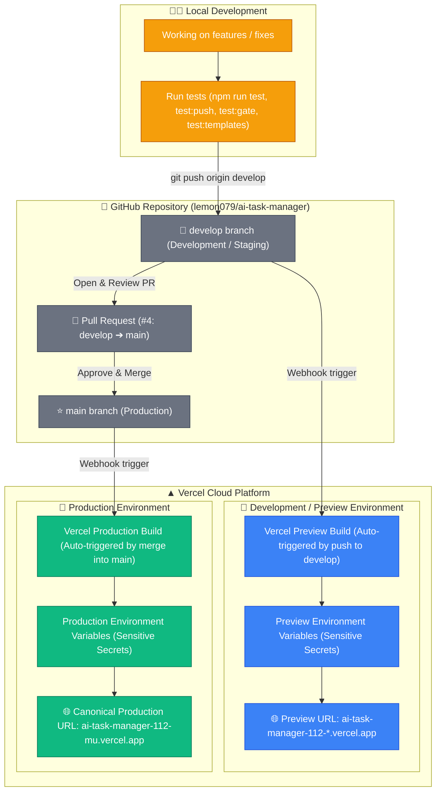

# GitHub Branches & Deployment Pipeline Architecture

This document illustrates how Git branches, GitHub Pull Requests, and Vercel environments are connected, and how Development (Preview) and Production environments operate with complete separation.

---

## 1. High-Level Architecture Diagram



---

## 2. Environment Comparison Matrix

| Aspect | Development / Preview (`develop`) | Production (`main`) |
|---|---|---|
| **Git Branch** | `develop` | `main` |
| **Vercel Target** | **Preview** | **Production** |
| **Deployment Trigger** | Automatic on every `git push origin develop` | Automatic on PR merge into `main` |
| **Public URL** | `https://ai-task-manager-112-*.vercel.app` | `https://ai-task-manager-112-mu.vercel.app` |
| **Purpose** | Verification, testing new features, mobile PWA testing | Live end-users, installed desktop/mobile PWAs |
| **Environment Variables** | Configured for **Preview** environment | Configured for **Production** environment |
| **Safety Net** | Safe to break, iterate, test migrations and edge cases | Strictly guarded; zero breaking changes allowed |

---

## 3. How Separation Works

1. **Independent Triggers**:
   - Pushing code to `develop` **only** creates a preview deployment. It will **never** touch or overwrite the live production app.
   - The production deployment is **only** triggered when changes are explicitly merged into `main`.

2. **Isolated Environment Variables**:
   - Vercel allows assigning secrets and environment variables by environment target: `Production`, `Preview`, and `Development`.
   - VAPID keys, database URLs, and API tokens can be scoped individually so preview tests never affect production data.

3. **Gated Progression (The Golden Flow)**:
   ```
   1. Develop & test locally
         ↓
   2. git push origin develop
         ↓
   3. Vercel generates Preview deployment URL
         ↓
   4. You test & verify on phone / desktop preview URL
         ↓
   5. Open Pull Request (develop → main)
         ↓
   6. Merge Pull Request
         ↓
   7. Vercel automatically deploys to Production URL
   ```
